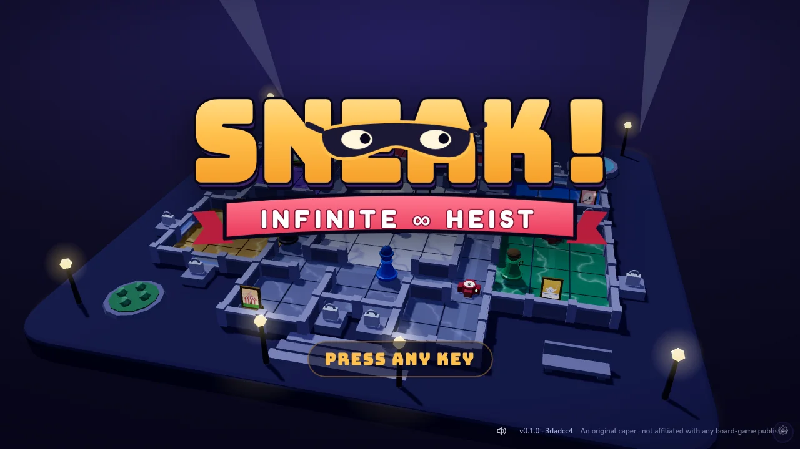
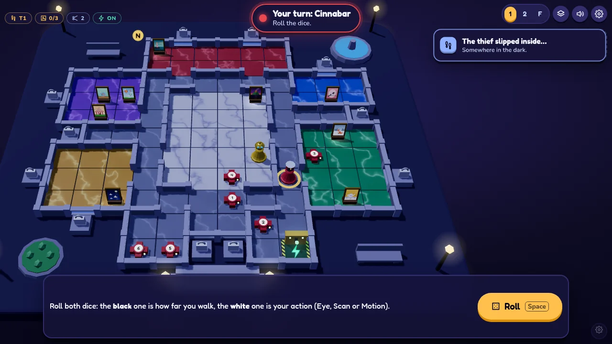
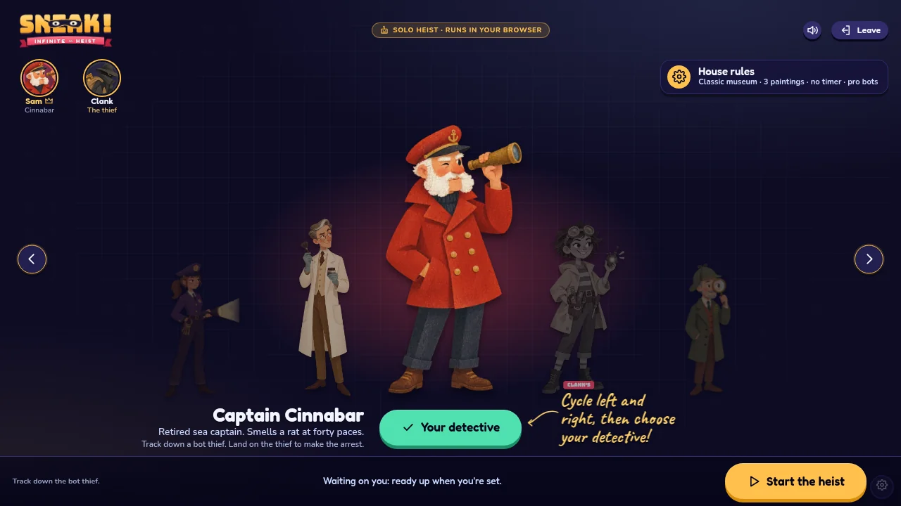
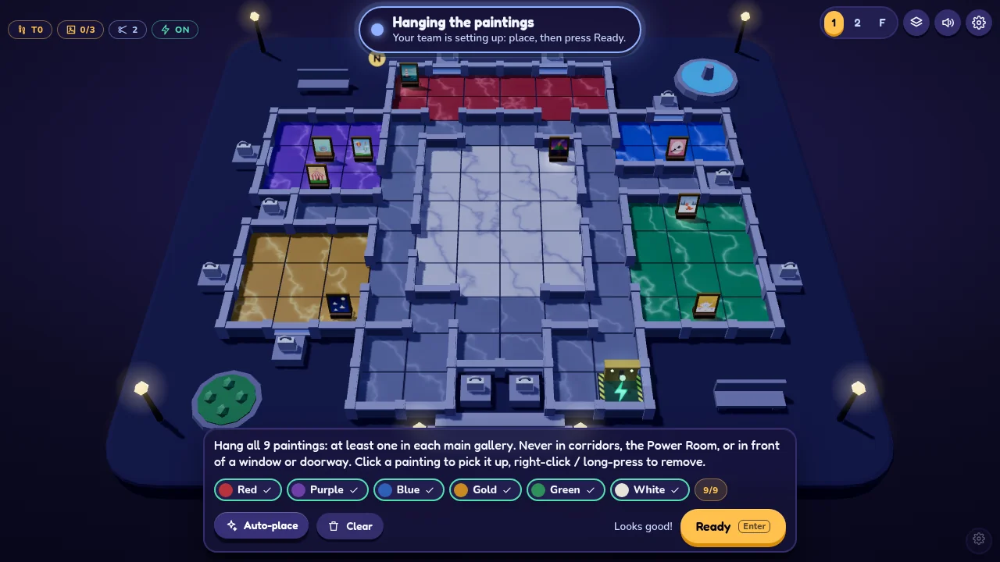

#  Sneak! Infinite Heist

[](https://github.com/crcatala/sneak-infinite-heist/actions/workflows/ci.yml)
[](LICENSE)

**A hidden-movement museum heist for 2–4 friends online, or solo against bots, all in the browser.**

One player is the thief, sneaking through a toy-like 3D museum at night with their position secret. The detectives
roll dice, check sightlines and cameras, and close in. Nothing to install, no sign-up.

> [!NOTE]
> **Unofficial fan project.** Sneak! Infinite Heist is inspired by *Clue: The Great Museum Caper* (1991). It isn't
> affiliated with or endorsed by Hasbro, Parker Brothers or any of their brands. See [Credits](#credits).

<p align="center">
  
</p>

## Features

- **Hidden movement.** The thief's position is secret. Detectives deduce it from dice rolls, sightlines, cameras and
  motion sensors, while the server keeps every player's view honest.
- **Play with friends or bots.** Host an online room for 2–4 players, or play solo against bots, with no server and
  no sign-up.
- **Choose your game.** Single round or a full match where everyone takes a turn as the thief. Turn timers, pro or
  rookie bots, and optional detective aids.
- **Mouse, touch, keyboard and gamepad.** The board rotates and zooms, a debug console helps with testing, and the
  lobby is a one-screen character select.
- **Cheap to host.** The whole game is one Cloudflare Worker with Durable Objects, designed to stay within the free
  plan.

## Screenshots

<p align="center">
  
</p>

<table>
  <tr>
    <td width="50%"></td>
    <td width="50%"></td>
  </tr>
  <tr>
    <td align="center">Choosing a detective in the lobby</td>
    <td align="center">Hanging the paintings during setup</td>
  </tr>
</table>

## Quick start

You need [Node.js](https://nodejs.org/) 24 (what CI uses).

```bash
git clone https://github.com/crcatala/sneak-infinite-heist.git
cd sneak-infinite-heist
npm install
npm run dev          # http://localhost:3000
```

Open <http://localhost:3000>, press any key, then **Play Solo**. Solo mode runs entirely in your browser. For online
rooms on your machine, the debug console, and testing from another device, see [Development](docs/development.md).

### Deploy to Cloudflare

You need a free [Cloudflare](https://dash.cloudflare.com/sign-up) account.

```bash
npx wrangler login                          # once: authorize Wrangler with your account
npm run deploy                              # build and deploy the Worker
npx wrangler secret put ROOM_CODE_SECRET    # e.g. the output of: openssl rand -base64 32
npm run invite:new -- sam                   # prints an invite entry (sam:<key>) and its magic link
npx wrangler secret put INVITE_CODES        # paste entries, comma-separated: sam:<key>,jo:<key>
```

Wrangler prints your site URL. Anyone can play solo there. Send each friend who should host their magic link,
`<site URL>/?invite=<key>`. See [Deploying to Cloudflare](docs/deployment.md) for the full walkthrough, invite
management and the kill switch.

## How to play

Each round, the thief moves after every detective turn. The detectives roll a movement die and an action die (Eye,
Scan or Motion) to look for the thief, disable cameras, and cut the power. The thief wins by escaping through an
unlocked exit with enough paintings. The detectives win by catching them.

The full rules, controls, and lobby settings are in the [Gameplay guide](docs/gameplay.md).

## Configuration

Online play is configured with Worker secrets (`npx wrangler secret put <NAME>`). Locally they live in `.dev.vars`,
created from [`.dev.vars.example`](.dev.vars.example) on the first `npm run dev`.

| Secret | Default | What it does |
|---|---|---|
| `ROOM_CODE_SECRET` | none (required for online rooms) | Signs room codes. Changing it invalidates every existing room code. |
| `INVITE_CODES` | none | `label:key` pairs, comma-separated. Each key lets a browser host online rooms. |
| `ONLINE_ENABLED` | on | Kill switch: set to `false` to turn all online rooms off. Solo keeps working. |
| `DEV_CHEATS` | off | Local development only: lets the debug console peek at hidden information. Never set it in production. |

## Costs and free-plan limits

Sneak! is designed to run for free on Cloudflare's Workers free plan. Static files are free, and rooms sleep between
moves. On the free plan, going over a daily limit doesn't bill you: online rooms stop working until the daily reset,
while solo keeps working. The worst-case numbers are in [Costs and free-plan limits](docs/deployment.md#costs-and-free-plan-limits).

## Documentation

- [Gameplay guide](docs/gameplay.md): rules, controls, the lobby, and lobby settings.
- [Deploying to Cloudflare](docs/deployment.md): setup, invites, the kill switch, costs and limits.
- [Development](docs/development.md): local setup, testing from another device, the debug console, and checks.
- [Architecture](docs/architecture.md): code map, the authoritative server, and how hidden information is kept.
- [Art](docs/ART.md) and [style guide](docs/STYLE.md): how the visuals were made and their look.
- [Rules research](docs/research/game-analysis.md): the analysis behind the rules.

## Contributing and security

Issues and bug reports are welcome. Code contributions aren't being accepted yet, so please open an issue before
sending a pull request. See [CONTRIBUTING.md](CONTRIBUTING.md). To report a vulnerability, see
[SECURITY.md](SECURITY.md). Forks are welcome under the [MIT License](LICENSE).

## Credits

Sneak! Infinite Heist is an unofficial, fan-made game inspired by *Clue: The Great Museum Caper* (Parker Brothers,
1991), designed by John LaBelle, Thomas Rabideau and Dave Rabideau. It's a non-commercial project, made to play with
friends.

- It isn't affiliated with, sponsored by or endorsed by Hasbro, Parker Brothers or any of their brands. *Clue* is a
  trademark of Hasbro, Inc.
- No artwork, rules text, logos, characters or other assets from the original game are used. The 3D models and
  textures, and the nine paintings, are original and made in code for this project.
- **Music** (`public/audio/music`) was generated with [Suno](https://suno.com) on a paid plan. It isn't covered by this
  project's MIT license and stays under Suno's terms, so check them before reusing a track.
  `node scripts/normalize-music.mjs <dir>` rebuilds the level-matched MP3s from raw exports.
- **Sound effects** (`public/audio/sfx`) were generated with [ElevenLabs](https://elevenlabs.io) on a paid plan, from
  text prompts. They keep ElevenLabs' terms for paid-plan output.
- **Detective and thief portraits** (`public/art/detectives`) are original illustrations generated with OpenAI's image
  model from the prompts in [docs/ART.md](docs/ART.md).
- **Fonts:** Bungee, Fredoka, Nunito and Caveat, all under the SIL Open Font License, served by Google Fonts.
- **Built with** React, Three.js, React Three Fiber and drei, zustand, zod and Cloudflare Workers.

If you're a rights holder and have a concern, please open an issue or email crcatala@gmail.com.

## License

The source code is released under the [MIT License](LICENSE). The license covers this project's own code. Generated
music and sound effects keep the terms of their generators (see [Credits](#credits)), and the license grants no rights
to the original board game or its trademarks.
